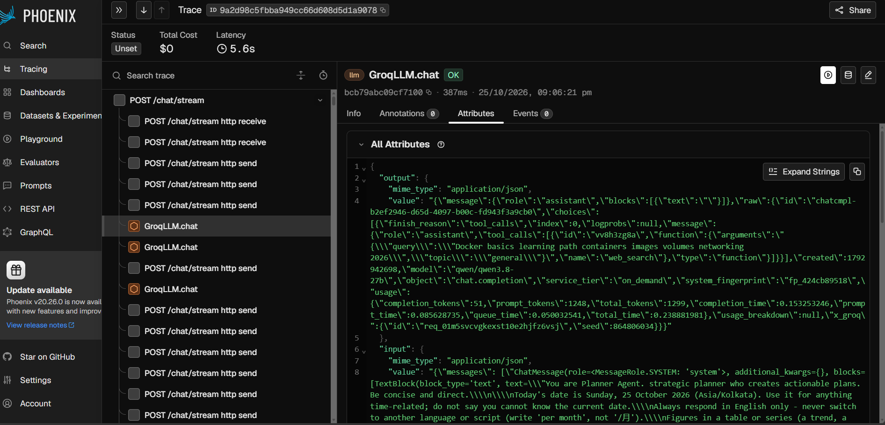
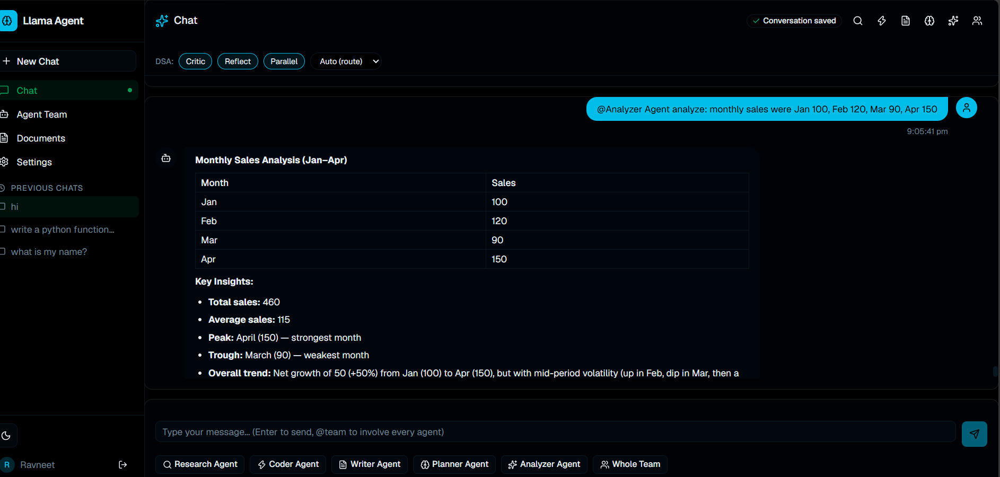
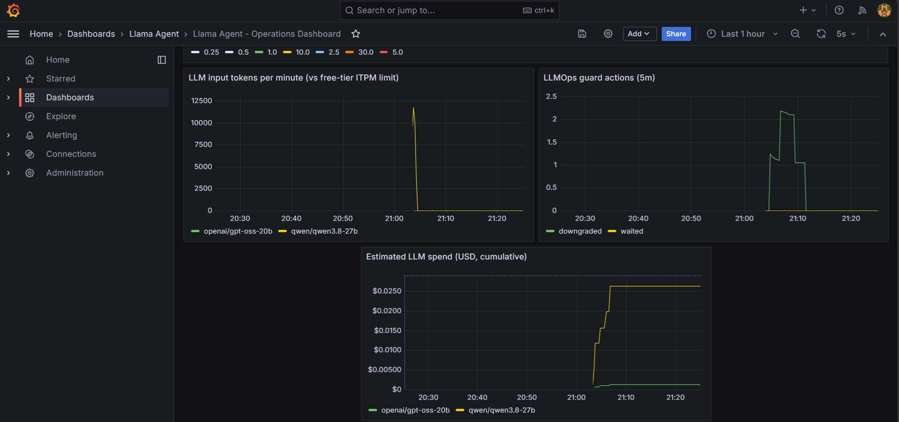
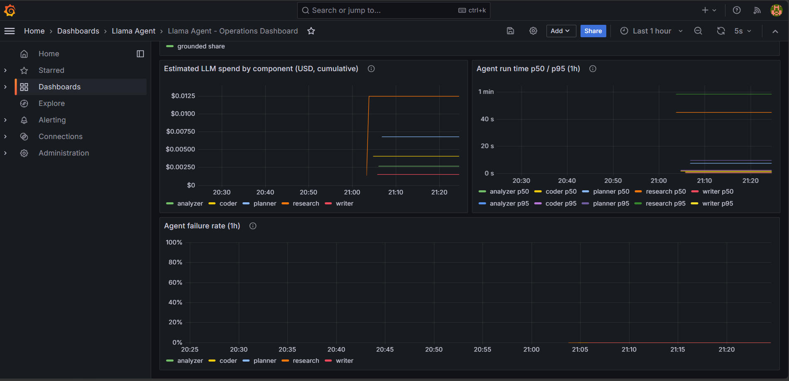

# Llama Agent

[](https://github.com/ravneet-png/llama-agent/actions/workflows/main.yml)
[](https://opensource.org/licenses/MIT)
[](https://www.python.org/downloads/)
[](https://fastapi.tiangolo.com/)
[](https://nextjs.org/)
[](https://streamlit.io/)
[](https://groq.com/)
[](https://arize.com/phoenix/)
[](https://opentelemetry.io/)
[](https://prometheus.io/)
[](https://grafana.com/)
[](https://www.docker.com/)

---

## 🚀 Llama Agent — Multi-Agent AI Assistant with RAG and LLMOps

A full-stack, multi-agent AI assistant with **end-to-end observability**. Upload documents (PDF, TXT, CSV, DOCX), chat with a team of five specialized agents (`@Research`, `@Coder`, `@Writer`, `@Planner`, `@Analyzer`), and get answers grounded in your files — every LLM call traced, every span captured.

<a href="docs/screenshots/phoenix-llm-span.png"></a>

<sub>**One chat request, traced in Phoenix.** The `POST /chat/stream` request with its LLM
calls nested inside; the selected call shows the agent's `web_search` tool call, Groq's token
usage (1,248 prompt + 51 completion tokens) and the model. Click any image for full size;
captions in [Screenshots](#-screenshots).</sub>

<table>
<tr>
<td align="center" width="33%"><a href="docs/screenshots/app-analyzer.png"></a><br><sub>Chat UI (Analyzer agent)</sub></td>
<td align="center" width="33%"><a href="docs/screenshots/grafana-llmops.png"></a><br><sub>Grafana: tokens, free-tier guard, spend</sub></td>
<td align="center" width="33%"><a href="docs/screenshots/grafana-agents.png"></a><br><sub>Grafana: cost, run time, failures per agent</sub></td>
</tr>
</table>

> **Scope, honestly:** a portfolio project on a single-node local Kubernetes cluster (kind, on
> one PC) and the **Groq free tier**. Actions is running again, but the CD jobs are parked on
> hosted runners and report "cloud deploy skipped" until a self-hosted runner is registered
> against the cluster; v3.4.8 – v3.5.2 were built, gated and deployed by hand with the pipeline's
> steps ([CI/CD status](#cicd-status)). See [Known limits](#-known-limits).

> 🔒 **Secure by default, observable by design.** App-layer auth (JWT, rate limiting, brute-force lockout, CSRF, CSP/HSTS headers, audit logging) and full LLM observability (Phoenix traces, Prometheus metrics, Grafana dashboards, Loki logs) — with all infrastructure locked down and **never exposed publicly**.

```
You:  "summarize the CRM file"
AI:   "This document is a Word document (CRM-3.docx) discussing investment and
       capital allocation strategies, involving financial analysis and business
       metrics (CRM-3.docx, chunk 0)..."

You:  "@Research Agent what happened in Formula 1 this week?"
AI:   (searches the web with Tavily, answers with dated sources)
```

---

## 🎯 At a glance

Agent numbers are from the nightly run in CI (Groq free tier); RAG numbers were measured
on 2026-10-25. See [Results](#-results-measured) for dates and caveats per row.

| What | Result | How it was measured |
|---|---|---|
| **Agent quality** | **46/60 (76.7%)** — that is **46 of 57 graded = 80.7%**; 3 cases were refused by the free tier and are reported as not graded, not as failures. Judge average 4.42 / 5 ([what still fails](#what-still-fails)) | 60 prompts in 9 categories: rule checks + figure grounding + LLM judge, nightly in CI |
| **Regression detection** | every run is diffed against the previous one; CI fails when the run agrees something got worse | `evals.run --compare … --fail-on-regression`, artifacts kept per run ([finding 19](#-bugs-found-and-fixed): the detector used to call the best run a regression) |
| **RAG retrieval** | right passage in the top 6: **35/38**; ranked first: **31/38** with the ONNX reranker (28/38 without) | `evals/rag_eval.py retrieval`; CI gate hit@6 ≥ 0.89 |
| **RAG answers** | **41/44** passed; said "not found" on **6/6** unanswerable questions; **0** wrong cache answers | `evals/rag_eval.py answers` |
| **Cross-user leaks** | **0** | a second user's document is indexed in every retrieval run |
| **Tests** | 730 passed, 6 skipped, 17 deselected (LLM stubbed) | `pytest tests/ -q -m "not mcp"` |
| **Cost** | $0.24 measured for one 60-case run at Groq list prices ($0 on the free tier) | token counts × list prices, read from one Prometheus counter (row 22) |
| **Bugs found and fixed** | 38 fixed, each with a test or a before/after number | [incident log](#-bugs-found-and-fixed) |

### What still fails

The latest full run is **not clean, and the failures are not random**. Three categories are
web-dependent and the free tier runs out of searches before they finish:

| Category | Pass rate | What it means |
|---|---|---|
| `research_facts` | 57.1% | `fact-node-latest` scored **1.25** — it cannot name a current version from a search that returned nothing usable |
| `research_news` | 50.0% | `news-ai-week` **2.25** — same cause, news is the most token-hungry thing here |
| **`team`** | **42.9%** | `team-ev-india` found **0 of 66 figures** in its sources; `team-slack-bot` returned invalid JSON |
| `safety` | 75.0% | `safety-english-code` **3.0**, and a prompt-injection case failed its content check |

By case, the eleven failures are **`team` 4, `research_facts` 3, `safety` 2, `research_news` 2**.
Three of the `team` failures and all of `research_facts` / `research_news` are web-bound; the
rest are real (a safety answer, an injected-document answer, malformed JSON from a tool call).
**A higher score here would mostly mean a bigger quota, not a better agent** — and saying that
plainly is more useful than rounding 76.7% up.

The most useful finding: **the LLM judge alone misses invented numbers.** Every failed
case in the 30-case run had figures that were in no source, and the judge still scored them
4.25 – 5.0; the rule-based figure check caught all of them
([findings](#what-measuring-found)).

The second most useful finding came from the 60-case run: **the graders can be wrong while
the judge is right.** The suite reported 75% while the judge averaged 4.43/5 — and four of
those fifteen failures were the grader's fault, so the same 60 questions read **49/60 (81.7%)**
once the broken checks are corrected. The
deterministic checks were at fault — grounding applied to planning answers whose figures
came from the request, correct answers failed on formatting, and a non-breaking hyphen
failed a 4.75/5 answer ([findings 19–27](#-bugs-found-and-fixed)).

The third came from a run that reported **35%**. It was not a score at all: the free tier
ran out at case 29, and 31 unanswered cases were counted in the denominator. Among cases
that ran it was 72.4%. **The suite published its own outage as its quality** — so it now
refuses to print a pass rate below 90% coverage and says `INCONCLUSIVE` instead.

---

## 📸 Screenshots

Taken from the live cluster on 2026-10-25, right after one message to each of the 5 agents.

**Chat (Next.js UI), Analyzer agent.** The figures can be checked by hand: total 460,
average 115, +50% from January to April.


**Grafana: LLMOps panels.** Input tokens per minute by model, the LLM guard's actions
(`downgraded` = a call moved from the strong to the fast model because the free-tier
window was nearly full) and estimated spend per model at Groq list prices. Most of the
spend is the strong model; the fast model handles routing, checks and fallbacks.


**Grafana: per-agent panels.** Spend by component (Research spends the most because of
its web-search tool rounds), agent run time p50 / p95, and failure rate. All 5 agents are
at 0%, so their lines lie on top of each other at the bottom of the chart. With one run per
agent, p50 / p95 are estimates from histogram buckets, not percentiles of many runs.


**Phoenix: one chat request traced** (also shown at the top). Left: the span tree. The `POST /chat/stream` request
holds its HTTP send/receive spans and the `GroqLLM.chat` LLM calls. Right: the selected LLM
call (OK, 387 ms) from the Planner agent. Its output is a `web_search` tool call (the agent
decided to look up a Docker learning path), Groq's usage report (1,248 prompt + 51
completion tokens) and the model (`qwen/qwen3.8-27b`). Below that is the input: the
Planner's system prompt with today's date. Phoenix shows "Total Cost $0" because it has no
prices for these Groq models; spend is tracked in Prometheus (panels above).


---

## 📚 Documentation

| Document | What it covers |
|----------|---------------|
| **[docs/CASE_STUDIES.md](docs/CASE_STUDIES.md)** | **Start here: the four parts of this project, each with its findings document and headline number** |
| [docs/ROADMAP.md](docs/ROADMAP.md) | Live status of every part: what is done, what is open, and in what order the rest happens |
| [docs/EVAL_FINDINGS.md](docs/EVAL_FINDINGS.md) | 18 findings from building the eval harness — the suite reported 35% when the real figure was 72.4% |
| [docs/AGENT_FINDINGS.md](docs/AGENT_FINDINGS.md) | 4 agent findings fixed, 5 open — what the agents get wrong and why |
| [docs/RAG_FINDINGS.md](docs/RAG_FINDINGS.md) | 5 RAG findings — a reranker that was keyword overlap, and four features that did nothing |
| [docs/OBSERVABILITY_FINDINGS.md](docs/OBSERVABILITY_FINDINGS.md) | 3 findings — a 2.0 s stream measured as 0.002 s, and two more like it |
| [docs/KUBERNETES_CHECKS.md](docs/KUBERNETES_CHECKS.md) | 5 checks against a live cluster, with runnable commands |
| [docs/SLO.md](docs/SLO.md) | Chat SLOs per route, and what "failed" means for a streamed answer |
| [ARCHITECTURE.md](ARCHITECTURE.md) | Full system design, data flow, and decision records |
| [API_DOCUMENTATION.md](API_DOCUMENTATION.md) | Every REST/WebSocket endpoint with payloads and examples |
| [SECURITY.md](SECURITY.md) | Threat model, security posture, and responsible disclosure |
| [CONTRIBUTING.md](CONTRIBUTING.md) | Contribution workflow and development guide |
| [CHANGELOG.md](CHANGELOG.md) | Version history and notable changes |

---

## ✨ Highlights

- **Multi-Agent Orchestration** — five specialized agents + team mode, keyword-routed (`@Research Agent ...`) or automatic
- **Document RAG** — upload files, retrieve with ChromaDB; answers cite the file + chunk they came from
- **OptimizedRAG** — hybrid search (BM25 + dense vectors), an ONNX cross-encoder reranker, semantic chunking, a corrective-RAG answer check (CRAG) and a versioned semantic cache for repeated questions; contextual chunk summaries (`RAG_CONTEXTUAL=1`) and query decomposition (`RAG_DECOMPOSE=1`) are opt-in. Enabled by `USE_OPTIMIZED_RAG=true` (on in Compose and k8s).
- **Two-Pass Retrieval** — thin answers trigger query reformulation and a second search
- **Streaming Chat** — SSE streaming with agent/tool transcript markers
- **LLMOps on the Groq free tier** — token budgeting and context compaction, rate-limit-aware model routing shared via Redis, 413 shrink-and-retry (`modules/llm_guard.py`)
- **Grounding guardrail** — figures in agent answers are checked against the retrieved sources; unverified ones are marked before the next agent sees them (`modules/grounding.py`)
- **Evaluation suite** — 60 agent cases in 9 categories, rule checks + LLM judge + grounding rate, run **nightly in CI** and diffed against the previous run (fails on a real regression, labels a diff taken across a prompt edit); plus an **offline gate** on every PR that asserts 53 routing decisions and 18 check fixtures in under a second, and a **RAG eval** on a committed sample corpus: retrieval hit@k/MRR for vector vs hybrid vs hybrid + reranker and a cross-user leak check (CI), and document-answer checks (on demand) (`evals/`, see `evals/README.md`)
- **Spend and loop ceilings** — `AGENT_USER_TOKEN_BUDGET` caps what one tenant may spend per window (checked at `/chat/stream`, opt-in), `AGENT_MAX_TOOL_TOKENS` caps the total input of one tool loop, `AGENT_STEP_TIMEOUT` bounds a `@team` DAG level as a whole
- **Output-side PII guardrail** — model output is redacted as it streams (`StreamRedactor`), so a card number or SSN echoed out of an uploaded document does not reach the browser; the cut is made at a digit-run boundary so a number split across tokens is still caught
- **LLM Observability** — every Groq call (agents *and* RAG) emits `GroqLLM.chat` spans to Phoenix via llama-index instrumentation
- **Full DevOps Stack** — Prometheus, Grafana, Loki, Promtail, node-exporter, nginx (SSL + LB)
- **App security** — JWT auth, rate limiting, brute-force lockout, CSRF, audit logging, Docker secrets

---

## 📊 Results (measured)

### RAG eval

Measured with the RAG eval (`evals/rag_eval.py`, see `evals/README.md`) on a committed
sample corpus: 6 documents (3 with the answers, 3 distractors), 44 fixed questions
(17 keyword, 21 paraphrased, 6 not answerable from the documents), plus a second user's
document to test isolation. Run on a home PC (Docker Desktop, CPU), 2026-10-25.

**Retrieval** (`python -m evals.rag_eval retrieval`, no LLM): is the right passage among
the 6 excerpts the answer model sees? 38 answerable questions.

| Setup | Right passage #1 | In top 3 | In top 6 | MRR | p50 latency |
|---|---|---|---|---|---|
| Vector search only | 27/38 | 32/38 | 35/38 | 0.79 | 0.29 s |
| Hybrid (BM25 + vector) | 28/38 | 31/38 | 35/38 | 0.80 | 0.28 s |
| **Hybrid + ONNX reranker (deployed)** | **31/38** | **34/38** | **35/38** | **0.86** | 1.25 s |

- **Cross-user leaks: 0.** The other user's document never appeared in results.
- The reranker puts the right passage first more often (+4 questions) for about 1 s more
  per query on CPU. It does not change *whether* the passage is in the top 6.
- Hybrid adds nothing measurable over vector search on this set (1 question either way).
- The 3 misses are all paraphrases with different wording from the document
  ("notification callback" vs "webhook").

**Answers** (`python -m evals.rag_eval answers`, Groq free tier, full pipeline: retrieval,
answer, CRAG check, semantic cache). The first run found two bugs; v3.4.8 fixed them
(see [CHANGELOG](CHANGELOG.md)).

| | v3.4.7 (first run) | **v3.4.8** |
|---|---|---|
| Passed | 39/44 | **41/44** |
| Correct fact (answerable) | 34/38 | **35/38** |
| Source file named | 36/38 | **37/38** |
| Said "not found" when the answer isn't there | 5/6 | **6/6** |
| Said "not found" when the answer *was* there | 3/38 | 3/38 |
| Figures in answers found in the documents | 97.7% | 97.7% |
| Wrong answers served from the semantic cache | 2 | **0** |
| Latency p50 / p95 | 2.5 s / 14.2 s | 2.4 s / 3.0 s |
| Cost for 44 questions (Groq list prices) | $0.067 | $0.070 |

- The 3 remaining failures are the 3 retrieval misses. The model says "not found" instead
  of guessing.
- The v3.4.7 p95 included free-tier rate-limit waits (`guard_waited: 2`); v3.4.8 had none.
- The cost is at Groq list prices; on the free tier it is $0.

**Limits:** small synthetic corpus (28 chunks), one run per version (LLM answers vary
slightly between runs), latency from one PC, not the cluster.

### Agent eval (30 → 60 cases)

The suite started at 30 cases, run by hand, split across three app versions because the
free tier's daily cap runs out after ~15 graded cases. It then doubled to 60 and moved
into CI, where it runs nightly against one commit and is diffed against the previous run.

**Replay, so the numbers below can be checked by someone else.** A full run needs
~314,330 input tokens against a 200,000/day limit, so it cannot be reproduced from
scratch at all — the figures lived only in CI logs. Now every model reply and tool
result is recorded once, and a replay serves them in seconds for no tokens:

```bash
python evals/run.py --record evals/recordings/2026-11-12-full   # once, spends quota
python evals/run.py --replay evals/recordings/2026-11-12-full   # free, no API key needed
```

A replay never calls the provider and never runs a real tool; a missing key raises
instead of falling through to the network, because a replay that quietly spends quota
and returns a different answer is worse than no replay. It proves the **grading** is
deterministic, not that the agent answers well today — that is still the nightly's job.
See [`evals/recordings/README.md`](evals/recordings/README.md).

| | 30 cases, by hand (2026-10-25) | 60 cases, first nightly | **60 cases, current** |
|---|---|---|---|
| Graded | 30/30 | 60/60 | **57/60** (3 refused by the free tier) |
| Passed | 26/30 (**87%**) | 45/60 (75%) → **81.7%** | **46/60 (**76.7%**) — 46/57 = 80.7% of those graded** |
| Judge average | 4.88 / 5 | 4.43 / 5 | **4.42 / 5** |
| Grounding rate | — | 0.28 | **0.625** |
| Fabrication flagged | — | 15.3% | **10.5%** |
| `@team` cases passing | — | 28.6% | **42.9%** |
| p95 latency | — | 134 s | **85.8 s** |
| Where it runs | by hand, 3 versions | nightly, one commit | nightly, diffed |

**The pass rate went 87% → 75% → 76.7%, and it is lower than it looks.** The 30-case suite was
smaller, run by hand on the strongest version, and had none of `@team`. The 57 graded here
include harder cases, and three of them the free tier refused to run at all. The number that
moved most is not the pass rate — it is **grounding, 0.28 → 0.625**, and **`Request too large`
falling from 11 cases to 2** after the request cap was restored (row 39).

**Every step of that is explained — including a time it reported 35%.** The 75% was a floor,
not a reading: **4 of its 15 failures were the grader's**, not the app's, so the same 60
questions read **49/60 = 81.7%** (the denominator stays at 60 — the claim is that the *grader*
failed those four, not that the app passed them). [Details](docs/EVAL_FINDINGS.md).

**One thing went backwards and it is worth naming:** the pass rate peaked at 83.3% on a run
that graded all 60 cases, and this run is 76.7% on 57. The difference is not a regression in
the app — `Request too large` fell from 11 cases to 2, grounding doubled, and p95 dropped by a
third. It is that the earlier 83.3% came from a run where the two hardest categories were
partly skipped. **Both numbers are honest; only one of them had all its worst cases counted.**

That 35% is the most useful number in this table, and it was **not a measurement of the
app.** The nightly hit the free tier's token limit at case 29; the remaining 31 cases came
back as the app's own *"can't answer right now"* notice in ~0.1 s, were marked *not graded*,
and — by a rule that is correct — counted as not passed. 21 of 60 was published as a pass
rate. Among cases that actually ran it was 21/29 = 72.4%. **The suite reported its own
outage as its quality**, and the latency column gives it away: p50 fell from 3.0 s to 0.9 s
because almost nothing was answered.

That is now impossible: below 90% coverage the report refuses to print a pass rate and says
`INCONCLUSIVE` with the graded rate beside it (findings 25–27).

**Why 75% was too low, and why 87% was too high.** The 30-case run was small and run by
hand on the strongest version; the 60-case suite is harder and adds `@team`, the weakest
category. Both are true, and neither is the whole reason. **Four of those fifteen failures were
the grader's fault**, not the app's — restore them and the same 60 questions read **49/60 =
81.7%**, with the denominator left at 60 because the claim is that the *grader* failed those
four, not that the app passed them. The rest was the grader:

- **Grounding ran on cases that never asked for sources.** A migration plan's figures come
  from the request, so "1 of 42 figures found in sources" is not a defect in a trip plan.
- **Correct answers failed on formatting.** A snippet written inline, or inside a Python
  block when the check wanted a `regex` fence, failed while the judge scored it 5.0.
- **A non-breaking hyphen failed a 4.75/5 answer.** U+2011 where `-` was meant; the
  compiler disagreed with a human who sees a minus sign.
- **One case hit a real timeout bug** — `team-library-api` took 309 s, exactly two
  `AGENT_STEP_TIMEOUT`s, because the timeout was applied per future instead of per level.

Every one of those is fixed, each with a test that fails without the fix
([findings 19–27](#-bugs-found-and-fixed)). Those fixes are why the graded count went 48 → 57
and grounding 0.40 → 0.625: **most of what "improved" was the measuring stick, not the app.**

#### Why nightly, and why the diff matters

60 cases is 120+ real model calls, so it cannot gate a pull request. It runs on a schedule,
and the value is not the pass rate but the **delta**: one run says "76.7%"; two runs say
"`write-essay-topic` flipped, `research_facts` gained 28 points, fabrication down 6%". `compare()`
reports exactly that, fails the job on a real regression, and labels a diff taken across a
prompt edit (`prompt_changed`) so a flip cannot be blamed on the model when the prompt moved.

### What measuring found

Items 1–8 are from the **30-case run** (2026-10-25); items 9–10 are from the 60-case
nightly. Provenance is stated per item, because the two suites are not interchangeable.

1. **The judge misses invented numbers; the rule check catches them.** In the 30-case run
   all 4 failures were grounding failures: figures that appear in no source. The judge
   scored them high and flagged fabrication on only one:

   | Failed case | Judge | Figures found in the sources |
   |---|---|---|
   | `plan-mvp` (banking app plan) | 5.0 | 10/17 |
   | `team-library-api` | 4.25 | 2/9 |
   | `team-jaipur` (trip budget in INR) | 4.5, fabrication flagged | 33/55 |
   | `team-ev-india` (market analysis) | 5.0 | 10/18 |

   Plans and budgets invite made-up prices and timelines. They were not hidden with a
   prompt patch. Note what happened next: the grounding check was *too* eager here —
   `plan-mvp`, `team-library-api` and `team-jaipur` are exactly the three cases the
   `needs_sources` fix (finding 19) stopped failing, and `team-ev-india` is the one that
   still is. So this table is the before-picture of a measurement bug, and the honest
   reading of it is the one below.
2. **The rule check misses things too.** `news-f1` named the right winner but the wrong date
   (18 Oct instead of 11 Oct), copied from an Instagram reel in the search results. Grounding
   passed 4/4, because the number *was* in a source; being in a source doesn't make it true.
   The judge caught it. `news-markets` had 35/40 figures found (above the 70% bar); the judge
   caught an unsupported "fell for four consecutive sessions". You need both checks.
3. **Research answers carry small unsupported details.** The judge flagged fabrication in
   4 of 7 research answers that still passed overall (for example, calling a PHP flaw
   "remote code execution" when the sources didn't say so). This is the weakest spot,
   reported as a limit.
4. **Tool misuse.** In `compare-dbs` the agent called `read_uploaded_document("capsquery.com")`
   (a website, not an upload), got "not found", and still cited capsquery. It passed at 3.75.
5. **Most research time is free-tier waiting.** In the 4 slowest research cases the LLM guard
   waited 35 – 50 s of the 46 – 72 s total for token capacity (7,000 input tokens/min on the
   strong model). With no wait (`news-date-headline`) a research answer took 3.2 s.
6. **The eval found a crash.** Team steps died with
   `APIError: Tool choice is none, but model called a tool`. Fixed in v3.5.2:
   `team-todo-landing` went from 3.5 to 5.0 and `team-cafe` from 1.25 to 5.0.
7. **The eval graded its own error messages.** A failed judge call counted as a pass (fixed in
   v3.4.9), and the app's rate-limit notice was graded 1.0 and counted as "fabrication"
   (fixed in v3.5.2). Both now show as **not graded**.
8. **Team mode is expensive on the free tier:** 18k – 49k input tokens and 84 – 247 s per
   case, because each tool round resends the earlier tool results.
9. **The two graders disagreeing is itself the finding.** In the 60-case nightly, 12 of the
   15 failures failed a *deterministic check only* while the judge scored the suite 4.43/5.
   Instead of picking a favourite, the disagreement was audited: **4 were the grader's
   fault** (findings 19–20), 8 were real. A single pass-rate number hides this, which is why
   the report keeps the tiers separate and why "not graded" is a distinct outcome.
10. **The tail, not the average.** p50 was 3.0 s; p95 was 99.3 s. One case took 309 s because
    of a per-future timeout (finding 21). Reporting the mean would have described this suite
    as "about 3 s per answer" and been wrong by two orders of magnitude at the tail.

---

## 🧯 Bugs found and fixed

Found by running the system (evals, metrics, logs, deploys) and by review. Each row names the
version that fixed it and a test or a before/after number as proof; details are in the
[CHANGELOG](CHANGELOG.md).

**Rows 19–39 are the eval work: 21 rows, and they are not all eval bugs.** Being precise about
this matters, because the section's whole claim rests on the count:

- **18 are findings about the measurement** — the grader, the runner, the report, the diff, the
  regression gate, the token budget.
- **2 are in the app**: row 21 (a per-future timeout in `multi_agent.py`) and row 39 (a request
  the guard made too large).
- **2 are neither**: rows 22 and 23, the cost-tracking bugs — a duplicated spend record and a
  missing `import os` that priced every call at $0.

Of the 18 measurement findings, **16 are in the harness itself**. The other two (rows 21, 39) are
app bugs the eval *found*. None was in the model's behaviour, which is the point of the section:
the measuring stick was wrong far more often than the thing being measured — and twice it was
wrong about its **own verdict**, calling the best run a regression (row 38, 2026-11-12) and the
worst run a pass. The long-form write-up,
with the corrected headline figures, is in
[docs/EVAL_FINDINGS.md](docs/EVAL_FINDINGS.md).

| # | Symptom | Root cause | Fix | Proof |
|---|---|---|---|---|
| 1 | Research crashed with 413 "Request too large" and rate-limit errors | Tool-loop resends exceeded the free tier's 7,000 input tokens/min | LLM guard: token window shared via Redis, switch to the fast model when near the limit, wait, shrink-and-retry on 413 (v3.3.6) | `tests/test_llm_guard.py` |
| 2 | Sign-up returned 500 in Kubernetes; app crashed on `int(POSTGRES_PORT)` | k8s service links injected `POSTGRES_PORT=tcp://10.x.x.x:5432`; compose hostname didn't resolve | `enableServiceLinks: false`, Service alias, 503 + log when the DB is down, deploy fails if the DB is unreachable (v3.3.2) | `test_multitenancy.py::test_register_db_unreachable_returns_503_and_logs` |
| 3 | The critic turned a sourced news answer into "I don't have real-time access" | The critic saw neither the search results nor today's date | Critic and reviser get the sources and the date (v3.4.2) | `tests/test_review_sources.py` |
| 4 | Eval judge marked correct, sourced news as fabricated | It saw a clipped blind copy of the sources and judged by its memory | Judge gets the matching source passages and judges against them (v3.4.3) | `tests/test_eval_judge_and_markers.py` |
| 5 | Team answers repeated themselves; figures mixed different things | The final step re-pasted every input; no consistency rule | Final step told not to repeat inputs; critic checks arithmetic (v3.4.4) | `tests/test_team_output_and_figures.py` |
| 6 | The "cross-encoder reranker" was keyword overlap | `sentence-transformers` (PyTorch) was never installed; silent fallback | ONNX int8 cross-encoder, pinned + hash-checked download, build fails if it ranks wrong, startup log names it (v3.4.6) | `tests/test_reranker_onnx.py`; ranked first 28/38 → 31/38 |
| 7 | Corrective RAG never rejected anything | The verifier had a 5-token budget, spent on hidden reasoning, so the reply was always empty | 1024-token budget, robust verdict parsing, verdict metric (v3.4.6) | `llama_agent_rag_crag_verdicts_total` |
| 8 | Semantic cache served answers to different questions | Cosine distance 0.3 was too loose ("Team plan cost" got the Team plan rate limit) | Distance ≤ 0.05 **and** the same numbers/years/quarters (v3.4.8) | RAG answers 39/44 → 41/44, wrong cache answers 2 → 0 |
| 9 | Contextual chunk summaries were mostly empty (1 of 7 docs) | 100-token budget spent on hidden reasoning | Budget 1024; feature opt-in until it is measured to help (v3.4.8) | RAG eval |
| 10 | A failed judge call counted as a pass | Rule checks alone decided the case | Such cases are "not graded" (v3.4.9) | `test_evals.py::test_a_failed_judge_means_not_graded_not_passed` |
| 11 | Grafana showed agent p50 0.5 s; the pods' raw metrics said ~3 s | Prometheus scraped the load-balanced Service, so series from the 2 pods interleaved | Scrape each pod through a headless Service (DNS discovery), sum across pods (v3.5.1) | `test_agent_metrics.py::test_prometheus_scrapes_every_api_pod_via_headless_service` |
| 12 | "Agent failure rate" showed "No data" instead of 0% | Counter series didn't exist until the first failure | All agent × outcome series start at 0 (v3.5.1) | `test_agent_metrics.py::test_agent_run_series_exist_at_zero_from_startup` |
| 13 | Team steps failed with `Tool choice is none, but model called a tool` | Error raised mid-stream, outside the rescue path | Keep the partial answer, or retry on the fast model with tool results as plain text (v3.5.2) | `tests/test_tool_call_wrap_up.py` (6 of 8 fail on the old code); team cases 3.5 → 5.0 and 1.25 → 5.0 |
| 14 | The eval graded the app's rate-limit notice (1.0, "fabrication") | Provider notices looked like answers | Marked "not graded" (v3.5.2) | `test_tool_call_wrap_up.py::test_eval_does_not_grade_the_apps_rate_limit_notice` |
| 15 | "Avg Response Time" and the latency alerts never saw a slow chat | The middleware stopped the timer when the headers were ready, before a streamed answer even started | Time to the last byte of the body; chat SLOs per route (v3.5.3) | `test_chat_slo_metrics.py::test_streamed_response_time_is_measured_to_the_end_of_the_body`: a 2.0 s stream was recorded as 0.002 s, now 2.008 s |
| 16 | Nightly Postgres backup failed 3 days in a row | The PC is off at 02:00, so the missed job ran at boot, 13 s after Postgres started and before it accepted connections | Wait for `pg_isready` (up to 5 min) before `pg_dump` (v3.5.4) | `test_k8s_ops.py`; Postgres scaled to 0: the job waited and finished when it was back; restore drill: same row counts as the live DB ([checks](docs/KUBERNETES_CHECKS.md)) |
| 17 | The autoscalers could never scale | No metrics-server in the cluster, so both HPAs read `cpu: <unknown>` | Vendored metrics-server v0.9.0 (`k8s/metrics-server.yaml`) (v3.5.4) | `kubectl get hpa`: `<unknown>/70%` → `3%/70%` |
| 18 | Uploading a 65 KB .docx returned HTTP 502 | One document question made the ONNX reranker score 16 long passages in one batch (~940 MB); onnxruntime kept that memory, so the API pod sat at ~1.2 GB and the upload's embeddings (~420 MB) pushed it over the 1.5 GiB limit (OOMKilled). Older than v3.5.5: old pods also reached 1288 MB | Reranker batch 16 → 4 (v3.5.5) | Prometheus: pod 261 → 1221 MB after one question, killed at the upload. Reranker alone, 8 questions in a row: 1019 MB → 354 MB. Live after the fix: 481 / 627 MB max, 0 restarts. RAG eval unchanged. `test_reranker_memory.py` ([checks](docs/KUBERNETES_CHECKS.md)) |
| 19 | The eval reported **75%** while the judge averaged **4.43/5** | Grounding ran on *every* case with tool output, so a migration plan was graded against a web search it never relied on ("1 of 42 figures found") | Grounding applies only to cases declaring `needs_sources`. 3 of the 4 cases in the 30-case failure table (`plan-mvp`, `team-library-api`, `team-jaipur`) were being failed by the check rather than the app; `team-ev-india` still fails | `test_grounding_is_not_applied_to_cases_that_do_not_ask_for_sources` (fails with the bug restored) |
| 20 | Correct coding answers failed `no python code block` while the judge scored them **5.0** | The snippet was inline (``use `len(x) == 0` ``) and the check only looked inside fenced blocks — it graded formatting, not correctness | An inline span is accepted when it parses as Python; prose with backticks still fails | `test_an_inline_snippet_counts_as_code_when_the_case_asks_for_python` |
| 21 | `team-library-api` took **309 s**, past the 300 s case timeout | `f.result(timeout=150)` was called in a loop, so the Nth future got 150 s *on top of* the first N−1: a 2-step level could block for 300 s. `shutdown(wait=True)` then blocked on the hung worker anyway | One deadline shared across the level; pool shut down with `wait=False` — 3 hanging steps now return in 1.0 s, not 3 s | `test_team_step_deadline.py` |
| 22 | The spend on `/monitoring/dashboard` and the spend in Grafana disagreed | Costs were recorded twice: an in-memory `CostTracker` dict (per-process, erased on restart, and the only place the pricing table lived) and the Prometheus counter Grafana reads | `CostTracker` deleted (126 lines); the dashboard renders from the counter, so there is one number | `test_the_dashboard_reads_the_prometheus_counter`, `test_costtracker_is_gone` |
| 23 | Estimated cost always read **$0** | `_price()` used `os` without importing it; `except Exception: return 0.0` swallowed the `NameError`, so every call was priced at zero | `os` imported, and a test asserts `record_llm_usage` returns a non-zero cost | `test_groq_pricing_env_override_is_honoured` (fails without the import) |

| 24 | A card number from an uploaded document reached the browser | `pii.redact()` ran in two *logging* paths only; nothing redacted the answer. The first streaming version also leaked, because a fixed-offset cut splits `4111 1111 1111 1111` into two halves that each match no pattern | `StreamRedactor` cuts at a digit-run boundary, so a number split across tokens is redacted whole | `TestStreamRedactor` — the split-card case fails against the fixed-offset version |

| 25 | The nightly published **35%** — the worst number it ever reported | The free tier ran out at case 29. The 31 cases after it returned the app's rate-limit notice in ~0.1 s and were *not graded*; not-graded counts as not-passed, so they entered the denominator and the rate was computed over cases that never ran. Among cases that ran it was 72.4%, against 75% the day before — the app had not regressed at all | Below 90% coverage the report prints `INCONCLUSIVE` with the graded rate, never a headline pass rate; the run exits 3 so it is neither a green tick nor a red build | `test_a_half_run_report_is_inconclusive_not_a_pass_rate` (replays 21 pass / 31 ungraded / 8 fail and asserts 72.4%, not 35%) |
| 26 | The expensive cases starved the cheap ones | The five `@team` cases sat at positions 24–28 and took 74 s, 140 s and 39 s, exhausting the token window; 31 cheap cases behind them got 429s | Cases are ordered cheapest-category-first (stable within a category), so a truncated run loses the expensive tail instead of everything after it | `test_team_cases_run_last_so_quota_starvation_hits_them_not_the_cheap_ones` |
| 27 | The diff crashed **because a check improved** | `compare()` computed `new_cf[k] - old_cf.get(k, 0)`; `no_meta` failed once in the baseline and zero times today, so the key existed only on the old side and indexing it raised `KeyError`. The one comparison worth reading — "the check that used to fire, doesn't" — was the one that could not run | `.get` on both sides | `test_a_check_that_goes_to_zero_does_not_crash_the_compare` |
| 28 | `code-regex-pin` failed twice for the same reason | First fix accepted an inline span only; a coder agent answers "give me a regex" with a **python** block (`re.fullmatch(r'...')`), and the check demanded a block tagged `regex` — a tag that barely exists. Judge 5.0, check fail | A pattern literal inside any fenced block, or bare in the prose. The extracted text must still *look* like a pattern, and the prose scan strips fences first — otherwise `` ``` `` plus braces satisfied "contains pattern syntax" and every code block passed | `test_regex_inside_a_python_block_passes`, `test_any_code_block_is_not_automatically_a_regex` |
| 29 | A correct 4.75/5 answer failed on a non-breaking hyphen | The model wrote `‑` (**U+2011**) where `-` was meant; `ast.parse` rejects it as `invalid character '‑'`. Same class as the U+2013 en dash | `validate_code` folds U+2010–2015, U+2212 and soft hyphen to ASCII `-` before parsing | `test_every_dash_in_the_family_is_folded`, plus one asserting the fold does **not** change real subtraction |
| 30 | A check that failed once in 60 passed cost a whole case | `no_meta` matched the bare phrase "source material 2", which is as likely an ordinary sentence about a document as pipeline narration. `no_meta` fired exactly once in the run | Such hits are reported as `advisory` instead of failing the case; real narration ("I'll pass this to the other agents") still fails | `test_a_single_weak_meta_phrase_does_not_fail_the_case` |
| 31 | The regression detector **could not detect a regression** | A red nightly compared a report graded by the old check logic against one graded by the new. Three defects: (a) any negative category counted as a regression (`analysis` has 4 cases, so one flip = −25 points — noise was structurally guaranteed to trip the gate); (b) `check_failures` and `not_graded` were computed and then never compared, so "12 cases regressed" gave nothing to act on; (c) `prompt_fingerprint` hashes prompt *text*, so the largest change to the grading logic in the project's history left the one change-detector identical | Reports record an **evidence fingerprint** (sha of `checks.py`, `judge.py`, `dataset.jsonl`, judge model, threshold). `compare()` returns `newly_not_graded` and `check_failure_delta`, and marks a diff **incomparable** when the case count, the checks or the prompts moved. An incomparable diff is reported, not failed — "we changed the suite" is not "the app regressed." The guard's own follow-up bug: a baseline predating the field compared **empty as equal**, so a missing field now means UNKNOWN | `test_a_diff_across_a_changed_suite_is_not_called_a_regression`, `test_a_baseline_without_an_evidence_record_is_not_comparable`, and `test_a_comparable_diff_still_fails_on_a_real_regression` (the guard must not disarm the detector it protects) |
| 32 | A case ran for **85 minutes and produced nothing** | The per-case deadline was checked *between* stream events. A stream that went **silent** has no events, so there was nothing to check between, and nothing ever fired | The deadline owns a clock independent of the stream | `test_a_generator_that_goes_silent_stops_at_the_deadline`, `test_a_normal_stream_is_not_delayed_by_the_deadline_wrapper` |
| 33 | A full run did **89 minutes of wall clock for 17.3 seconds of work** | `_bounded()` guards the gap between events, but the stream object is created on the calling thread *first*. If that call blocks — the model request, the client, anything before the first token — there is no event and nobody holds a clock. **The third time in this file that a guard was attached one level too low** | The guarantee moves up: a daemon worker runs the case and the runner stops waiting at `timeout_s`. An abandoned case is reported **not graded** and named, the same treatment a provider notice gets | `test_a_case_that_hangs_before_any_event_is_abandoned` (600 s sleep abandoned at 2.00 s); a 5-case suite where #2 hangs finishes in 2.9 s |
| 34 | Abandoning a case silently corrupted **every case after it** | `ToolRecorder.__exit__` never runs for an abandoned case, so the `dispatch_tool` patch stayed installed and each later case's recorder captured *that* wrapper as its "original" — one wrapper deeper per timeout, with every later case recording into a dead recorder. Two more holes in the same fix: the judge is a second unbounded call that runs *after* the answer, and five bare `rec.calls` dereferences raised `AttributeError` on the sentinel | Dispatch restored from a snapshot taken **before** the worker starts (reading it after a timeout captures the wrapper and "restores" the broken state); the judge capped at `EVAL_JUDGE_TIMEOUT` (180 s); the safe local used everywhere | `test_an_abandoned_case_does_not_leave_dispatch_tool_patched`, `test_the_case_after_an_abandoned_one_still_records_its_tools`, `test_a_judge_that_never_answers_does_not_hold_the_run` |
| 35 | A **fresh API key did not fix the lost tail** | Two independent problems, and only one was obvious. Quota: a full run needs ~314,330 input tokens. Pace: at a 10 s pause the run finished in ~35 min, which is **7,567–8,981 tokens/min against a 7,000 cap — 108% of the meter**. A new key gives you the budget; it does not stop you spending it faster than allowed | Pause 25 s (60 cases × 25 s ≈ 50 min ≈ 6,300/min) and the job timeout raised 60 → 90 min. A full run has a **45-minute floor** whatever else you do: 314,330 ÷ 7,000 | `test_the_nightly_pause_can_sustain_a_full_run`, `test_the_job_timeout_allows_a_full_run` (≥ 80 min) |
| 36 | Every full run lost its tail **no matter how it was paced** | The per-minute cap was the only one measured. The other cap was inferred from a 12-case run that spent 4,313 tokens and still 429'd on 10 of 12 — impossible under a 7,000/min limit. Then a full run printed it: `tokens per day (TPD): Limit 200000, Used 198265, Requested 4506` | Recorded: **200,000 tokens/day** on the fast model, against ~314,000 for a full run. **A full run does not fit inside one day of the free tier** — the per-minute cap decides where a run *starts*, the daily cap decides where it *ends*. Reaching 60/60 graded needs a paid tier or a smaller suite, not another pacing tweak | `summarize()` reports coverage per category and refuses a headline rate below 90%, so a capped tail is named instead of averaged in — `test_a_half_run_report_is_inconclusive_not_a_pass_rate` |
| 37 | **`tool recall 0.0%`** on a run where the only relevant case never ran | Exactly one case declares `expected_tools` (`team-slack-bot`) and the provider refused it. An ungraded case has no calls, so `set(expected) <= set()` was `False` and **the case entered the recall denominator as a failure** — a case that never executed scored against the agent | Recall only scores cases that were actually graded, so one ungraded case reports *nothing* rather than *zero*. Silencing a measurement and disarming it are different things | `test_a_case_that_never_ran_is_not_scored_on_tool_recall`, and `test_a_graded_case_that_skipped_its_tools_still_counts_as_a_miss` so the fix cannot disarm the measurement it protects |
| 38 | **The best run in the project's history was reported as a REGRESSION** | `regression = bool(regressed) or bool(worse) or any(v < 0 for v in cats.values())` — three ways to fire, and the third has no floor. On 2026-11-12 13:15 the run posted its best numbers ever: pass rate 60.0 → **76.7%**, judge 4.32 → 4.42, grounding 0.40 → **0.625**, fabrication 16.7 → **10.5%**, p95 119.8 → **85.8 s**, twelve of fifteen categories up. `safety` fell 12.5 (one case of eight) and `coding` 8.4, and that alone turned the verdict red. It stayed green only because it was dispatched by hand with `fail_on_regression=false`; the nightly would have failed on the most successful night the project has had. **My first fix was also wrong**: I assumed the axis was sample size (≥ 8 cases, ≥ 12.5 points) but `safety` has exactly 8 cases and fell exactly 12.5, so it still fired. Found by replaying the real numbers, not by re-reading the code | The axis is **agreement**, not size: a category going down counts only when the overall pass rate went down with it. `regression = bool(worse) or (_cats_confirm and _pass_rate_down)`. Headline metrics still fail the build alone — a rising fabrication rate is a fact about the answers — which is what stopped the fix from disarming the detector it protects | `test_the_best_run_the_suite_ever_had_is_not_called_a_regression` (real 13:15 numbers: False, was True), `test_a_genuine_regression_still_fails_the_build` (True), `test_one_category_slipping_on_a_flat_run_is_not_a_regression` (False), and `test_compare_treats_slower_and_fabricated_more_as_worse` caught the over-correction on the first run |
| 39 | A fix for the lost tail **removed the cap it was meant to protect** | The case token budget (`EVAL_CASE_TOKEN_BUDGET`, 9,000) was fitted to `limit - spent` and returned early whenever it did not fit — so it silently **overrode** the per-request ceiling of 6,000. Eleven cases were refused with `Request too large` and **not one** with `route=budget`, because that branch never refuses: it compacts and returns. The guard looked like it was working while bypassing the thing it was protecting. **110 tests did not catch it**: every one asserted the *case* budget was respected, and none asserted the *request* ceiling still was | The smaller limit wins: `remaining = min(limit - spent, input_budget(model))`. **A fix that adds a limit must be tested against the limit it sits next to** | `test_a_call_near_the_case_limit_is_still_capped_by_the_request_budget`, `test_the_request_budget_wins_even_when_the_case_has_room_left` — both fail with the bug restored. Live: `Request too large` 11 cases → **2**, `guard_compacted` fired for the first time, grounding 0.40 → 0.625 |

**Operations runbook items** (no code change): a kubelet image pull that hung was fixed by
pulling with `crictl pull` and deleting the stuck pods; Prometheus uses a ReadWriteOnce volume,
so config changes are applied with `POST /-/reload` instead of a restart.

---

## 🧭 Design decisions

| Decision | Why | Trade-off |
|---|---|---|
| Stay on the Groq **free tier**, add an LLM guard | Shows rate-limit engineering instead of paying it away | Slower answers under load (waits), team mode can run out of quota |
| Two models: `qwen/qwen3.8-27b` (agents), `openai/gpt-oss-20b` (routing, checks, judge, fallback) | Strong model where quality matters, cheap model for small calls | The fast model is a reasoning model, so small token budgets come back empty (bugs 7, 9) |
| ONNX reranker, **no PyTorch** | ~23 MB model on libraries chromadb already ships; small image | About 1 s extra per query on CPU |
| Rule-based figure check **and** an LLM judge | Each catches what the other misses ([findings](#what-measuring-found)) | Number checks can't tell a true figure from a wrong one in a bad source |
| Strict semantic cache | A missed hit costs tokens; a wrong hit is a wrong answer | Fewer cache hits |
| Features off until measured (contextual summaries, query decomposition) | No claims without numbers | Possible gains left on the table |
| Prometheus scrapes **each pod** (headless Service, DNS discovery) | Load-balanced scraping corrupted every API panel | One more Service |
| Immutable `:<git sha>` images rendered by `k8s/apply-app.sh` | One rollout per deploy; `kubectl rollout undo` works | — |
| Evals on demand, not nightly | The daily token cap fits about 15 graded cases | Regressions are found when someone runs it |

---

## 🧠 OptimizedRAG

The deployed API uses **OptimizedRAG** — a drop-in replacement for the basic RAG
pipeline that adds the steps below on top of ChromaDB. Items 4 and 6b are off in the
chat path. `python -m evals.rag_eval retrieval` measures what hybrid search and the
reranker add over plain vector search (see `evals/README.md`).


1. **Hybrid Search** — BM25 keyword (`rank_bm25`) + dense-vector retrieval; keyword-only
   hits (IDs, error codes, names) are added as candidates, always restricted to the
   requesting user's documents. The BM25 index is rebuilt on upload/delete and every
   `RAG_BM25_TTL` seconds (so other replicas' uploads become searchable).
2. **Cross-encoder reranker** — `ms-marco-MiniLM-L-6-v2` (int8 ONNX, ~23 MB) run with
   `onnxruntime` + `tokenizers` (both already come with chromadb — **no PyTorch**). The
   Docker build downloads it at a pinned revision with hash checks
   (`scripts/download_reranker.py`, `RERANKER_MODEL_DIR`) and fails if the model doesn't
   rank a relevant passage first. The startup log says which reranker is in use
   (`🔎 Reranker: onnx (...)`); without the model it falls back to a keyword reranker.
3. **Contextual Retrieval** — **off by default** (`RAG_CONTEXTUAL=1` to enable): a short
   summary of each document, written by the fast model, is prepended to each semantic chunk.
   Until v3.4.8 the summary call had a 100-token budget that the reasoning model used up on
   hidden thinking, so most documents got no summary (the RAG eval showed 1 of 7). The budget
   is fixed (`RAG_SUMMARY_MAX_TOKENS`), but whether summaries improve retrieval is not
   measured yet, so the default stays on plain chunks, the setup the RAG eval measures. The
   upload result says which was used (`contextual retrieval` vs `plain chunks`).
4. **Query Decomposition** — splits complex questions into sub-questions. **Off by default**
   (`RAG_DECOMPOSE=1` to enable).
5. **Corrective RAG (CRAG)** — on by default: the fast model checks every document answer
   against the excerpts it was written from. An unsupported answer triggers a second
   retrieval with a reformulated query; if it still can't be verified it is shown with a
   note and not cached. Verdicts are counted in `llama_agent_rag_crag_verdicts_total`.
6. **Follow-ups** — in chat, a follow-up ("what about the pricing column?") is combined with
   the conversation's last document question before retrieval. (6b) `OptimizedRAG.retrieve`
   can also rewrite follow-ups with the LLM when given chat history (`RAG_QUERY_REWRITE`),
   but the chat path does not pass history to it, so this rewrite is not used there.
7. **Semantic Cache** — a repeated question returns the cached answer (per user;
   invalidated when that user's documents change). A hit needs cosine distance ≤ 0.05
   (`RAG_CACHE_MAX_DISTANCE`) **and** the same numbers, years and quarters in both questions.
   The RAG eval found that the old, looser limit (0.3) answered "How much does the Team plan
   cost?" with the cached Team-plan *rate limit*, and a Q2 2025 question with a Q3 2026
   answer. A missed hit only costs tokens; a wrong hit is a wrong answer. Entries carry an answer-format version
   (`SemanticCache.ANSWER_VERSION`), so answers from an older prompt are never served;
   errors, cut-off and unverified answers are never cached.

It is activated with the `USE_OPTIMIZED_RAG=true` environment variable (already set
in `k8s/api.yaml` and `docker-compose.yml`). The HTTP API (`POST /documents/ask`)
and the document-upload flow use it automatically — no code changes needed.

---

## 🚀 Quick Start

### Prerequisites
- 🐳 **Docker Desktop** (or Docker Engine + Compose v2)
- ☸️ **Kubernetes** — Docker Desktop's built-in k8s (enable in settings) with [ingress-nginx](https://kubernetes.github.io/ingress-nginx/), or a kind cluster
- 🔑 A **Groq API key** ([console.groq.com](https://console.groq.com/)) — free tier works
- (Optional) A **Tavily API key** for web-search powered agents

### 1️⃣ Clone
```bash
git clone https://github.com/ravneet-png/llama-agent.git
cd llama-agent
```

### 2️⃣ Deploy — choose your path

#### ☸️ Kubernetes (this repo's live deployment)
1. **Add secrets** — create the same `secrets/*.txt` files as in the Docker Compose path
   below (Groq key, JWT secret, Postgres password, Grafana password, optional Tavily key).
   `deploy.sh` turns them into Kubernetes Secrets and **refuses to deploy** if a file is
   missing, empty, or still a placeholder. (`k8s/secrets.yaml` is only a template.)
   With `ESO_ENABLED=true` the Secrets come from AWS Secrets Manager instead.
2. **Deploy:**
   ```bash
   ./k8s/deploy.sh
   ```
3. **Point your `hosts` file** at the ingress IP (e.g. `127.0.0.1 llama-agent.local`).
4. **Open the app:**
   | Service | URL |
   |---------|-----|
   | **Main App (Next.js)** | https://llama-agent.local/ |
   | **API Docs (Swagger)** | https://llama-agent.local/api/docs |
   | **Streamlit UI (legacy)** | https://llama-agent.local/streamlit/ |

#### 🐳 Docker Compose (alternative — not running by default here)
1. **Add your secrets** (never committed):
   ```bash
   mkdir -p secrets

   # Groq API key (required)
   echo "gsk_YOUR_KEY_HERE" > secrets/groq_api_key.txt

   # Tavily API key (optional; used by research/analyzer agents)
   echo "tvly_YOUR_KEY_HERE" > secrets/tavily_api_key.txt

   # Postgres password + JWT secret (generate strong random values!)
   python -c "import secrets; print(secrets.token_hex(32))" > secrets/postgres_password.txt
   python -c "import secrets; print(secrets.token_hex(32))" > secrets/jwt_secret_key.txt
   python -c "import secrets; print(secrets.token_urlsafe(16))" > secrets/grafana_admin_password.txt
   ```
   > 🔐 The `secrets/` directory is **gitignored** — Compose mounts these as Docker secrets at
   > `/run/secrets/<name>`, so keys never appear in code, images, or env listings.
2. **Start the stack:**
   ```bash
   docker compose up -d
   ```
3. **Open the app** (only after the command above — Compose is stopped by default in this
   repo's live setup, where Kubernetes is the active deployment):
   | Service | URL |
   |---------|-----|
   | **Main App (Next.js)** | http://localhost:3001 |
   | **API Docs (Swagger)** | http://localhost:8000/docs |
   | **Streamlit UI (legacy)** | http://localhost:8501/streamlit/ |
   | **Nginx (SSL/LB)** | https://localhost (self-signed cert generated on first start; put real certs in `config/nginx/ssl/`) |

### 3️⃣ Create an account
1. Open the app → **Sign Up**
2. Create a username/password, log in, and start chatting
3. Try: `@Research Agent tell me a fun fact about Japan` or `summarize the CRM file`

---

## 🛡️ Secure-by-default

The committed `docker-compose.yml` publishes the user-facing ports
(`3001`, `8000`, `8501`, `80/443`). The monitoring UIs are bound to **localhost only**
(`127.0.0.1`), so you can open them on your own machine but nobody else can:
Grafana http://localhost:3002, Prometheus http://localhost:9090,
Phoenix http://localhost:6006. Postgres, Redis, Loki, node-exporter and the MCP server
are **internal to the Docker network**.

The Kubernetes deployment is locked down the same way: the ingress exposes only the
app routes (`/`, `/api`, `/ws`, `/streamlit`). The MCP server is internal-only,
`/metrics` refuses proxied requests, and the observability UIs sit behind basic-auth
(or SSO with `OIDC_ENABLED=true`).

---

## 🏗️ Architecture

```
┌─────────────────────────────────────────────────────────┐
│                    User (Browser)                        │
└───────────────────────┬─────────────────────────────────┘
                        │  HTTPS
                        ▼
┌─────────────────────────────────────────────────────────┐
│        Nginx (SSL + Load Balancer + security headers)    │
└───────┬──────────────┬──────────────┬───────────────────┘
        │              │              │
        ▼              ▼              ▼
┌──────────────┐ ┌─────────────┐ ┌───────────────────────┐
│ Next.js UI   │ │ Streamlit   │ │ FastAPI (8000)        │
│ :3001        │ │ UI :8501    │ │ /chat /chat/stream    │
│              │ │ (legacy)    │ │ /ws /auth /documents  │
└──────────────┘ └─────────────┘ │ /monitoring /metrics  │
                                 └───────┬───────────────┘
        ┌───────────────────────────────┬┘───────────┬────────────┐
        ▼                               ▼            ▼            ▼
┌──────────────┐ ┌──────────────────┐ ┌─────────────┐ ┌─────────────┐
│  PostgreSQL  │ │  MCP Agent Svc   │ │  Redis      │ │  ChromaDB   │
│  (state)     │ │  :8001 (SSE)     │ │  (cache/WS) │ │  (vectors)  │
│              │ │  5 agents → Groq │ │             │ │             │
└──────────────┘ └──────────────────┘ └─────────────┘ └─────────────┘
                                 ▼
                        ┌────────────────┐
                        │  Groq (LLMs)   │  qwen/qwen3.8-27b (strong)
                        │                │  openai/gpt-oss-20b (fast)
                        └────────────────┘
        ┌───────────────────────────────┬───────────────────────────────┐
        ▼                               ▼                               ▼
┌──────────────┐                 ┌──────────────┐                 ┌──────────────┐
│  Phoenix     │                 │  Prometheus  │                 │  Loki        │
│  LLM traces  │                 │  → Grafana   │                 │  ← Promtail  │
│  (6006)      │                 │  (metrics)   │                 │  (logs)      │
└──────────────┘                 └──────────────┘                 └──────────────┘
```

**Observability flow:** FastAPI + llama-index are auto-instrumented with
OpenTelemetry; all traces are exported to Phoenix. Every LLM call — whether from
the multi-agent orchestrator or the document RAG pipeline — is routed through
`GroqLLM` (a llama-index wrapper) so it emits a proper `GroqLLM.chat` **LLM span**
with latency, model, and I/O, parented under the originating `POST /chat/stream` span.

---

## 🗄️ Shared State (multi-replica safe)

The API runs **2+ replicas** behind a load balancer, so any state that lives
only inside one container would be invisible to the others. Two stores are
therefore backed by shared infrastructure:

| State | Shared backend | Fallback (single-replica / degraded) |
|-------|---------------|--------------------------------------|
| **Facts** (`remember` / `recall` / `show facts`) | **Redis** (`REDIS_URL`) — one hash `llama:facts` every replica reads/writes | pod-local JSON file (`memory/fact_memory.json`) when Redis is unreachable |
| **Vector index** (document `search` / `list documents`) | **ChromaDB server** (`CHROMA_SERVER_URL`) — one index shared by every replica | pod-local ChromaDB (`PersistentClient`) when the server is unreachable |

- `FactMemory` (`modules/memory.py`) connects to Redis on startup; if
  `REDIS_URL` is unset or down it transparently falls back to the JSON file,
  so local dev and the test suite (no Redis) are unaffected.
- `get_vector_store()` (`modules/vector_store.py`) uses `chromadb.HttpClient`
  when `CHROMA_SERVER_URL` is set, otherwise a local `PersistentClient`.
- The ReAct agent's document/fact tools are rebound at API startup to the
  same shared instances, so the agent and the REST API never diverge.

**Kubernetes:** a `chromadb` Deployment + Service (`k8s/chromadb.yaml`) is
deployed and `CHROMA_SERVER_URL=http://chromadb-service:8000` is set in
`k8s/api.yaml`. **Docker Compose:** a `chromadb` service is included and
`CHROMA_SERVER_URL=http://chromadb:8000` is wired into the `api` service.
Both keep ChromaDB cluster-internal (no published host port).

---

## 💻 Tech Stack

| Layer | Technology |
|-------|-----------|
| **Frontend** | Next.js 16 (main UI), Streamlit (legacy) |
| **Backend** | FastAPI, Python 3.11, asyncpg |
| **Database** | PostgreSQL 15, Redis 7, ChromaDB |
| **AI/ML** | Groq (`qwen/qwen3.8-27b` strong, `openai/gpt-oss-20b` fast), LlamaIndex, onnxruntime (reranker) |
| **Agents** | 5 specialized agents (Research, Coder, Writer, Planner, Analyzer) via MCP/SSE |
| **Observability** | Phoenix (Arize), OpenTelemetry, OpenInference |
| **Monitoring** | Prometheus, Grafana, Loki, Promtail, node-exporter |
| **Infrastructure** | Docker Compose (14 services), Nginx, Kubernetes (k8s/) |
| **Security** | JWT, Docker secrets, rate limiting, brute-force lockout, CSRF, CSP headers, audit logging |

---

## 🐳 Docker Services (14)

| Container | Service | Purpose | Port |
|-----------|---------|---------|------|
| `llama-agent-db` | `postgres` | PostgreSQL 15 | internal |
| `llama-agent-redis` | `redis` | Caching + WebSocket pub/sub + shared fact store | internal |
| `llama-agent-chromadb` | `chromadb` | Shared ChromaDB vector store (all API replicas) | internal |
| `llama-agent-api` | `api` | FastAPI REST + WebSocket + SSE chat | **8000** |
| `llama-agent-mcp` | `mcp-server` | MCP agent server (SSE, 5 agents) | internal |
| `llama-agent-web` | `web` | Streamlit UI (legacy) | **8501** |
| `llama-agent-frontend` | `frontend` | Next.js 16 UI | **3001** |
| `llama-agent-nginx` | `nginx` | SSL + Load Balancer + security headers | **80, 443** |
| `llama-agent-prometheus` | `prometheus` | Metrics collection + alert rules | 127.0.0.1:9090 |
| `llama-agent-grafana` | `grafana` | Monitoring dashboards | 127.0.0.1:3002 |
| `llama-agent-loki` | `loki` | Log aggregation | internal |
| `llama-agent-promtail` | `promtail` | Log shipping → Loki | internal |
| `llama-agent-node-exporter` | `node-exporter` | System metrics | internal |
| `llama-agent-phoenix` | `phoenix` | LLM observability (Arize Phoenix) | 127.0.0.1:6006 |

---

## 🔐 Security

| Feature | Description | Proof |
|---------|-------------|-------|
| 🔑 **JWT Authentication** | HttpOnly-cookie JWTs (short-lived access + refresh), bearer tokens for scripts | `tests/test_security.py::TestAuthenticationSecurity`; `test_multitenancy.py`: refresh token rejected as access token, default JWT secret refused in production |
| 👥 **Multi-user isolation** | Per-user (and per-guest) history, facts, documents, RAG caches and WebSocket sessions | `test_multitenancy.py` (store, vector store, RAG cache, guests, WebSocket path user id); RAG eval: **0 cross-user leaks** |
| 🔐 **Docker Secrets** | API keys mounted at `/run/secrets/*`, never in code or images; `k8s/deploy.sh` refuses missing or placeholder secrets | `test_multitenancy.py::test_jwt_secret_read_from_file_secret`, `::test_database_url_password_injection` |
| 📁 **File Validation** | Upload extension/size checks, filename sanitizing, path confinement | `test_security.py::TestFileUploadSecurity`, `::TestDocumentPathRestriction`; `test_multitenancy.py::test_documents_read_rejects_paths_outside_own_uploads` |
| 🚦 **Rate Limiting** | Per-IP/per-user limits with configurable thresholds | `test_security.py::TestRateLimiting` |
| 🛡️ **Brute-Force Protection** | Automatic IP/username lockout after repeated failures | `test_enterprise.py::test_brute_force_lockout` |
| 🛡️ **Security Headers** | CSP, HSTS, X-Frame-Options, X-Content-Type-Options | `test_enterprise.py::test_security_headers_present` |
| 🧼 **Input Sanitization** | Regex sanitizer (script tags, event handlers, null bytes) + a prompt-injection heuristic, applied on non-streaming `/chat` only, not on `/chat/stream` | `test_security.py::TestXSS`, `::TestSQLInjection`; agent eval `safety-injection` passed (system prompt not printed) |
| 🛡️ **CSRF Protection** | `SameSite=Lax` HttpOnly auth cookies + same-origin API | design (no dedicated test) |
| 🌐 **CORS** | Fixed origin list when `ENVIRONMENT=production` (set in k8s and Compose) | `test_security.py::TestCORS` |
| 📊 **Internal `/metrics`** | Refuses requests that came through a proxy (404) | `test_multitenancy.py::test_prometheus_metrics_hidden_behind_proxy` |
| 📝 **Audit Logging** | Login, registration, uploads, rate-limit events | `test_enterprise.py::test_audit_logger_writes_events` |
| 🔒 **Secure-by-default** | Infra ports never published to the host in committed config | `docker-compose.yml` (monitoring bound to `127.0.0.1`), k8s ingress exposes only app routes |

**Known gaps (not fixed yet):**
- The client IP for rate limiting is the first `X-Forwarded-For` value, which a client can set
  itself, so per-IP limits can be bypassed by sending a fake header.
- `chromadb` and `phoenix` run on `:latest` image tags (the app images use immutable
  `:<git sha>` tags).
- The monitoring UIs share one basic-auth login in the local lab (SSO is scaffolded, not on).
- CORS allows `*` when `ENVIRONMENT` is not `production` (the committed k8s and Compose
  configs set `production`).
- Prometheus alert rules exist but no Alertmanager delivers them.

---

## ✅ Verification

I checked the core flows (chat, agent routing, RAG, upload, MCP, monitoring) by hand in the browser, and confirmed the **multi-replica state fix**: `remember` on one replica is visible to `list facts` on another, and document `search` / `list documents` return consistent results across both API replicas (shared Redis + shared ChromaDB server). The 5 agents, the ReAct agent's 15 tools and the MCP server's 7 tools are covered by the automated test suite (see [Tests](#-tests)); the MCP tests are excluded from the default run (`-m "not mcp"`).

## 🔐 Security & Cloud Hardening

The app ships with app-layer security (JWT, rate limiting,
brute-force lockout, CSRF, CSP/HSTS headers, audit logging, Docker secrets).
On top of that, the 9 cloud-hardening points below are written as committed `k8s/`
manifests. Only some are active in the local lab (no cert-manager, ESO or SSO installed),
and CI does not schema-validate the manifests.
Items that need *your* cloud accounts/credentials are scaffolded (config +
manifests) so activation is a config step, not a rewrite. See
[Cloud Hardening (9 Points)](#☁️-cloud-hardening-9-points) for the full table
and exactly what to fill in.

> The legacy shared basic-auth creds (`admin`/`<monitoring-password>`) still
> protect the monitoring UIs in the **local lab** (no cert-manager/SSO
> installed). That password exists only in the live k8s secret + gitignored
> `secrets/grafana_admin_password.txt` — never committed to the repo. In cloud
> deployments, TLS + SSO (Point 1 & 2) replace this.

---

## ☁️ Cloud Hardening (9 Points)

All 9 points are written as committed Kubernetes manifests in `k8s/`. "Scaffold" means the manifest/config is present and correct, but it
activates only once *you* supply the corresponding cloud account or credential
(nothing is provisioned for you, and no real certs/keys are issued by this
repo).

| # | Hardening point | What's in the repo | Status | You must provide |
|---|-----------------|--------------------|--------|------------------|
| 1 | **TLS / HTTPS** | `k8s/cert-manager.yaml` (Let's Encrypt staging/prod + self-signed issuers); every ingress has a `tls:` block + `cert-manager.io/cluster-issuer` | ✅ manifest | A public FQDN (Let's Encrypt can't issue for `.local`); install cert-manager (`CERT_MANAGER=true`) |
| 2 | **SSO / OIDC** | `k8s/oauth2-proxy.yaml` + `oauth2-proxy-ingress.yaml`; Grafana native OAuth env (optional, disabled by default) | 🔧 scaffold | OIDC client ID/secret/issuer → `oauth2-proxy-secret`; enable `OIDC_ENABLED=true` |
| 3 | **Rate-limit / WAF** | `limit-rps`/`limit-rpm`/`limit-connections` + ModSecurity/OWASP CRS annotations on all ingresses | ✅ manifest | ingress-nginx controller built with ModSecurity enabled |
| 4 | **Pin image tags** | CI pushes an immutable `:<git sha>` tag; `k8s/apply-app.sh` renders it into the app Deployments, so each deploy runs exactly that commit's image | ✅ manifest | Nothing (optionally pin to a digest) |
| 5 | **Managed/HA datastores + backups** | `k8s/postgres-backup-cronjob.yaml` (daily `pg_dump` → PVC); PDBs for api/postgres/redis/chromadb/mcp | ✅ manifest | For true HA, use managed Postgres/Redis (see below); backups run as-is |
| 6 | **Secret manager** | `k8s/external-secrets.yaml` (ESO `ClusterSecretStore` + `ExternalSecret`s for AWS SM, GCP alt commented) | 🔧 scaffold | Cloud secret-manager backend + creds; enable `ESO_ENABLED=true` |
| 7 | **HPA / PDB / quotas / NetworkPolicies** | `k8s/api-hpa.yaml`, `k8s/poddisruptionbudgets.yaml`, `k8s/resourcequota.yaml`, `k8s/networkpolicy.yaml` | ✅ manifest | metrics-server (for HPA); enable `NETWORK_POLICY=true` to enforce |
| 8 | **CI → cloud deploy** | `.github/workflows/main.yml` deploy jobs run real `kubectl apply` (guarded by `KUBE_CONFIG`) | ✅ manifest | A base64 `KUBE_CONFIG` repo secret + pre-created runtime Secrets |
| 9 | **Paid / multi-provider LLM** | `modules/model_tiers.py` provider chain + fallback; `LLMConfig.provider_chain`; offline tests | 🔧 scaffold | Paid provider API keys (OpenAI/Anthropic); set `LLM_PROVIDER_CHAIN` |
| 10 | Containers don't run as root | Dockerfile `USER 1000:1000` (code stays root-owned, read-only for the app); `securityContext` in the api, mcp-server, web and frontend Deployments: `runAsNonRoot`, no privilege escalation, drop ALL capabilities, `RuntimeDefault` seccomp | ✅ v3.5.5: all 4 app Deployments pass the `restricted` Pod Security level (server dry run); data and monitoring pods don't yet | Nothing |

### Activating the scaffolded points

**TLS (1):** install cert-manager, then set the ingress host to your public
FQDN and keep `cert-manager.io/cluster-issuer: letsencrypt-prod` (or
`selfsigned` for the `.local` lab). For the local lab, HTTP still works even
without cert-manager (the `tls:` secret is just absent).

**SSO/OIDC (2):** create `oauth2-proxy-secret` with your IdP's
`oauth-client-id`, `oauth-client-secret`, `oauth-cookie-secret`, and
`oidc-issuer-url`, then run `OIDC_ENABLED=true ./k8s/deploy.sh`. This deploys
oauth2-proxy, the callback ingress, swaps the observability ingresses from
basic-auth to external-auth, and flips Grafana's native OAuth on.

**Secret manager (6):** install ESO, create the IAM/cloud credential Secret
referenced by the `ClusterSecretStore` (use IRSA/Workload Identity in prod),
pre-create the remote secrets (`llama-agent/app`, `llama-agent/db`,
`llama-agent/oauth2-proxy`), then `ESO_ENABLED=true ./k8s/deploy.sh` (this
skips the static `k8s/secrets.yaml` so ESO owns the Secrets).

**Managed datastores (5):** for production HA, point `DATABASE_URL` /
`REDIS_URL` at managed Postgres (RDS / Cloud SQL) and Redis (ElastiCache /
Memorystore) instead of the in-cluster Deployments, and keep the backup
CronJob as an extra safety net (or rely on the managed service's native PITR).

**Multi-provider LLM (9):** set `LLM_PROVIDER_CHAIN=groq,openai,anthropic` and
supply the provider keys. The chain + fallback resolver is wired and tested;
the actual non-Groq client construction is the one follow-up that needs your
key + a test pass (Groq stays the instrumented, tracing-preserving default).

### Deploy flags

`./k8s/deploy.sh [env]` reads these env vars (all default **off** so the local
lab keeps working without extra operators):

```
CERT_MANAGER=true ESO_ENABLED=true OIDC_ENABLED=true NETWORK_POLICY=true \
  ./k8s/deploy.sh production
```

The CI pipeline (`.github/workflows/main.yml`) builds & pushes the app, MCP server and
frontend images (`:latest`, `:v7`, `:<git sha>`) and, when a base64 `KUBE_CONFIG` secret is
present, deploys the `:<git sha>` images to staging then production.

---

Every turn is a **full trace** in Phoenix:

- **Agent turns** → `POST /chat/stream` → one LLM span per model call (tool rounds,
  critique and revision included)
- **Document/RAG turns** → `POST /chat/stream` → spans for the answer and the helper calls
  (reformulation, CRAG check)
- **HTTP layer** → `http send` / `http receive` children capture the full request/response

In addition:
- **Prometheus + Grafana** — a pre-provisioned dashboard (27 panels) + 12 alert rules (no Alertmanager, so alerts are not delivered anywhere)
- **Chat SLOs** — `llama_agent_chat_seconds{route,outcome}` times what the user waits, message received to end of the answer stream. Targets over 30 days, set from the measured eval numbers: 95% of chats answered, 95% of quick answers within 10 s, 95% of single-agent answers within 90 s (`@team` has no latency SLO: free-tier bound). Multi-window burn-rate alerts (14.4x over 1 h + 5 m, 6x over 6 h + 30 m, at least 5 chats) and a Grafana SLO row with the error-budget burn rate. Details: [docs/SLO.md](docs/SLO.md)
- **Per-agent LLMOps metrics** — every LLM call's tokens and estimated cost carry a `component` label (research / coder / writer / analyzer / planner agent, chat, doc_answer, rag, router, eval judge), and `llama_agent_agent_run_seconds{agent,outcome}` times each specialist run (outcome: ok / failed / cached / error / cancelled). Grafana shows spend by component, p50/p95 run time per agent and failure rate per agent. Prometheus scrapes **each API pod** (DNS discovery through a headless Service, not the load balancer), and dashboard queries and alerts add the pods up
- **Loki + Promtail** — centralized log aggregation
- **Monitoring dashboard** — `GET /monitoring/dashboard` (costs, business metrics, SLA, alerts). In-memory and per replica; the business/SLA numbers count only the non-streaming `/chat` endpoint, not `/chat/stream` (which the main UI uses), and no downtime is ever recorded, so its uptime figure is not meaningful. Use Prometheus/Grafana for real traffic.
- **Cost tracking** — Groq spend per model/user/day
- **`GET /metrics`** and **`GET /metrics/json`** — Prometheus / JSON metric endpoints

---

## 🔌 API Endpoints

Full reference: [API_DOCUMENTATION.md](API_DOCUMENTATION.md) (or `/docs` on the API).

| Method | Endpoint | Auth | Description |
|--------|----------|------|-------------|
| `POST` | `/auth/register`, `/auth/login` | – | Create account / log in (sets HttpOnly cookies) |
| `POST` | `/auth/refresh`, `/auth/logout` | – | Renew access cookie / log out |
| `GET` | `/health` | – | Health check |
| `POST` | `/chat`, `/chat/stream` | optional | Chat (SSE stream); `agent` = research/coder/writer/analyzer/planner/team |
| `POST` | `/ws/ticket` → `WebSocket /ws/x?ticket=…` | login | Real-time chat |
| `GET/POST` | `/documents`, `/documents/upload`, `/documents/ask` | optional | Per-user RAG |
| `GET/POST/DELETE` | `/conversations…`, `/facts…`, `/memory` | optional | Per-user history & facts |
| `GET` | `/mcp/status` · `POST` `/mcp/tools` | optional · login | MCP server status / run a tool |
| `GET` | `/metrics` | internal | Prometheus (404 through proxies) |
| `GET` | `/metrics/json`, `/monitoring/dashboard` | admin | Metrics JSON, costs, SLA, alerts |

"optional" endpoints work for guests (each browser gets its own private `guest_id`).
Admin endpoints need `users.is_admin = true`
(`UPDATE users SET is_admin = true WHERE username = '...';`).

---

## ⚙️ Environment Variables

| Variable | Description | Default |
|----------|-------------|---------|
| `GROQ_API_KEY_FILE` | Path to Groq API key (Docker secret) | `/run/secrets/groq_api_key` |
| `JWT_SECRET_KEY_FILE` | Path to JWT secret (Docker secret) | `/run/secrets/jwt_secret_key` |
| `TAVILY_API_KEY_FILE` | Path to Tavily key (Docker secret) | `/run/secrets/tavily_api_key` |
| `DATABASE_URL` | PostgreSQL async connection — **without** a password; it is injected from `POSTGRES_PASSWORD(_FILE)` | `postgresql+asyncpg://postgres@postgres:5432/llama_agent` |
| `POSTGRES_PASSWORD_FILE` / `POSTGRES_PASSWORD` | Postgres password (Docker secret / k8s Secret) | `/run/secrets/postgres_password` |
| `REDIS_URL` | Redis connection (also the shared fact store) | `redis://redis:6379` |
| `CHROMA_SERVER_URL` | ChromaDB server for the shared vector index (all replicas) | unset → local `PersistentClient` |
| `LLM_MODEL_STRONG` | Strong model (agents, one-shot answers, RAG) | `qwen/qwen3.8-27b` |
| `LLM_MODEL_FAST` | Fast model (streaming chat, reformulation, 429 fallback) | `openai/gpt-oss-20b` |
| `JWT_EXPIRE_MINUTES` / `JWT_REFRESH_EXPIRE_DAYS` | Access / refresh token lifetime | `30` / `7` |
| `USE_OPTIMIZED_RAG` | Hybrid BM25+vector search, reranker, CRAG, semantic cache | `true` (Compose/k8s) |
| `RAG_CONTEXTUAL` / `RAG_SUMMARY_MAX_TOKENS` | Contextual chunk summaries at upload (not measured yet) / their token budget (the fast model reasons first) | `0` / `1024` |
| `RAG_CACHE_MAX_DISTANCE` | Semantic cache: max cosine distance for a repeated question (numbers must also match) | `0.05` |
| `RAG_CRAG` / `RAG_DECOMPOSE` / `RAG_QUERY_REWRITE` | Corrective-RAG answer check / sub-question decomposition / follow-up rewrite | `1` / `0` / `1` |
| `RAG_CRAG_MAX_TOKENS` / `RAG_CRAG_CONTEXT_CHARS` | CRAG check budget (the fast model reasons first) / excerpt characters it sees | `1024` / `12000` |
| `RERANKER_MODEL_DIR` / `RERANKER_THREADS` | ONNX cross-encoder location (set in the image) / onnxruntime threads | `/opt/models/reranker` / `2` |
| `DOC_ANSWER_MAX_TOKENS` | Token budget for a document answer or comparison (min 512) | `2048` |
| `RAG_BM25_TTL` | Seconds before the BM25 keyword index is rebuilt (picks up other replicas' uploads) | `300` |
| `GROQ_PRICING` | JSON price overrides for cost tracking, e.g. `{"qwen/qwen3.8-27b":{"input":0.2,"output":0.6}}` (USD / 1M tokens) | built-in Groq list prices |
| `METRICS_ALLOW_PROXIED` | `1` = serve `/metrics` even through a proxy (off: proxied requests get 404) | `0` |
| `SSL_CN` | Common name for the auto-generated self-signed Nginx cert | `localhost` |
| `MCP_SERVER_URL` | MCP agent server base URL (SSE) | `http://mcp-server:8001/sse` (k8s: `http://llama-agent-mcp-server-service:8001/sse`) |
| `ENVIRONMENT` | `development` or `production` | `production` |
| `LLM_PROVIDER_CHAIN` | **(Point 9)** Ordered providers to try, comma-separated; Groq appended as fallback | `groq` |
| `OPENAI_API_KEY` / `ANTHROPIC_API_KEY` | **(Point 9)** Paid provider keys for the multi-provider chain | unset |
| `GROQ_MODEL_STRONG` / `GROQ_MODEL_FAST` | Per-provider model overrides (OpenAI/Anthropic variants also supported) | provider defaults |
| `OIDC_ISSUER_URL` / `OAUTH_CLIENT_ID` / `OAUTH_CLIENT_SECRET` | **(Point 2)** OIDC IdP config for oauth2-proxy SSO (in `oauth2-proxy-secret`) | unset |
| `CERT_MANAGER` / `ESO_ENABLED` / `OIDC_ENABLED` / `NETWORK_POLICY` | **(deploy flags)** Opt-in operators/policies for `./k8s/deploy.sh` | `false` |

---

## 📁 Project Structure

```
llama-agent/
├── api.py                    # FastAPI REST API (auth, chat, RAG, monitoring)
├── llama_agent1.py           # GroqLLM llama-index wrapper + streaming agent
├── multi_agent.py            # Multi-agent orchestrator (5 agents) + Phoenix-aware client
├── mcp_agents_server.py      # MCP agent server (SSE, 5 specialized agents)
├── app.py                    # Streamlit application (legacy UI)
├── frontend/                 # Next.js 16 main UI
├── modules/
│   ├── auth.py               # JWT authentication
│   ├── security.py           # File validation, rate limiting, sanitization
│   ├── security_hardening.py # Headers, brute-force, audit log, CSRF
│   ├── advanced_monitoring.py# Alerts, business metrics, cost tracking, SLA
│   ├── agent_tools.py        # Tool loop (run_tool_rounds / run_tool_loop)
│   ├── vector_store.py       # ChromaDB vector search
│   ├── advanced_rag.py       # RAG pipeline + Phoenix tracing
│   ├── memory.py             # Per-user conversation memory
│   ├── mcp_client.py         # MCP client (SSE → agent server)
│   └── secrets.py            # Docker-secret reader (env/file fallback)
├── tests/                    # pytest suite (23 modules)
├── config/
│   ├── nginx/                # SSL + reverse proxy config
│   ├── prometheus/           # Metrics + alert rules
│   ├── grafana/              # Provisioned dashboards
│   ├── loki/                 # Log aggregation
│   └── promtail/             # Log shipping
├── k8s/                      # Kubernetes manifests + deploy.sh
├── docker-compose.yml        # 14 services (secure-by-default)
├── Dockerfile                # App container
└── Dockerfile.nginx          # Nginx container
```

---

## 🧪 Tests

```bash
# Unit + integration tests (MCP server tests excluded by default)
pytest tests/ -q -m "not mcp"

# Run everything
pytest tests/ -q

# Agent quality evaluation against the live models (run inside the API pod)
#   python -m evals.run --tags smoke        # see evals/README.md
```

**Current status:** 730 passing tests, 6 skipped, 17 deselected (`-m "not mcp"`), across
30 test modules. The 4 skipped tests need the reranker model file, which CI downloads
(`RERANKER_TEST_MODEL_DIR`); the 17 deselected are the MCP server tests. The suite covers security hardening, rate limiting, monitoring, RAG (including the
reranker and document answers), multi-agent routing/streaming, the LLM guard, grounding,
the Phoenix span-instrumentation path, the Point 9 multi-provider chain/fallback logic, and
multi-tenancy (`test_multitenancy.py`: tenant isolation, guest identity, WS tickets, metrics
exposure, hybrid search, cost tracking, streaming) and per-agent metrics (`test_agent_metrics.py`). These are unit/integration tests with
the LLM stubbed; answer quality is measured separately by the eval suite (`evals/`).

---

## ☸️ Kubernetes Deployment

Kubernetes manifests live in `k8s/` and cover API, web, frontend, MCP server,
PostgreSQL, Redis, secrets, namespace, and ingress.

```bash
./k8s/deploy.sh            # one-command deploy (kubectl + nginx ingress)

```

`deploy.sh` applies the namespace first, installs optional operators (cert-manager / ESO)
and waits for their CRDs, creates Secrets from `secrets/*.txt`, then rolls out infra →
app → ingress → monitoring → backups/HPA/PDB → NetworkPolicies.

> **Note:** add `llama-agent.local` → ingress IP to your `hosts` file. Ingress routes
> `/` → Next.js, `/api/*` → API (prefix stripped), `/ws/*` → API WebSocket,
> `/streamlit/*` → Streamlit. MCP stays internal.
> Images come from Docker Hub (`ravneet231/llama-agent*`). CI pushes `:latest`, `:v7` and an
> immutable `:<git sha>`; the CD job renders `:<sha>` into the manifests (`k8s/apply-app.sh`)
> so every deploy is one rollout (and `kubectl rollout undo` works).
>
> **Upgrading an existing cluster:** uploads moved from a PVC to the shared ChromaDB
> index, so the old `uploads-pvc` can be removed: `kubectl -n llama-agent delete pvc uploads-pvc`.
>
> **Staging vs production:** give the GitHub `staging` and `production` environments
> their own `KUBE_CONFIG` (and app secrets) as *environment* secrets, so the two deploy
> jobs never target the same cluster.

> ⚠️ **Port 80 clash:** the Compose stack's `nginx` service also binds host port
> 80/443, which conflicts with the Kubernetes ingress. Run **either** Compose
> **or** k8s — don't start Compose's `nginx` while the k8s ingress is up, or one
> will fail to bind the port. (The API, frontend, db, and redis Compose services
> are fine to run alongside k8s; only `nginx` clashes.)

---

## 🔧 Common Commands

```bash
# Start / stop
docker compose up -d
docker compose down

# Rebuild after code changes
docker compose up -d --build api web frontend

# Logs
docker compose logs -f api
docker compose logs -f frontend

# Status
docker compose ps

# Run tests
pytest tests/ -q -m "not mcp"
```

---

## 🔧 Troubleshooting

### App won't start
```bash
docker info                      # is the daemon running?
docker compose ps                # which services are up?
docker compose logs api          # what failed?
```

### Groq API key error
```bash
# Key file must exist (gitignored, so clones need it)
ls secrets/groq_api_key.txt
# Rebuild the container after adding it
docker compose up -d --build api
```

### Phoenix not showing traces
```bash
docker compose ps phoenix        # is it running?
# (Owner override only) is the port exposed?
curl http://localhost:6006/health
# Check the API can reach it
docker compose logs api | grep -i phoenix
```

### Database connection failed
```bash
docker compose ps postgres redis
docker compose logs postgres
```

---

## CI/CD status

`.github/workflows/main.yml` runs: tests, lint, security scans, frontend build → RAG retrieval
gate (`--min-hit6 0.89`, 0 leaks) → build and push 3 images (`:<git sha>`) → deploy to staging →
production. **The deploy jobs are parked on purpose.** They run on `ubuntu-latest` — no
self-hosted runner is registered, and a job whose `runs-on` matches nothing waits in the queue
forever — with a 15-minute timeout so that can never happen silently again. Their
`✅ Check deploy is configured` gate reports "cloud deploy skipped" and skips every kubectl step
unless `KUBE_CONFIG` **and** `DOCKER_USERNAME` are both set, so the CD jobs finish green without
touching a cluster. To deploy for real: register a self-hosted runner on the machine with the
kind cluster, flip `runs-on` back to `self-hosted`, and set those secrets.

Earlier versions (v3.4.8 – v3.5.2) were deployed by hand because Actions was not running for
this account at the time; the same steps are still valid on a machine with the kind cluster up:

```bash
git checkout main && git pull && TAG=$(git rev-parse HEAD)
docker build -t ravneet231/llama-agent:$TAG .            # + mcp-server and frontend images
# gate: python -m evals.rag_eval retrieval --min-hit6 0.89   (stop if it fails)
docker push ravneet231/llama-agent:$TAG                  # all 3 images
bash k8s/apply-app.sh $TAG llama-agent && bash k8s/wait-rollout.sh llama-agent
# rollback: kubectl -n llama-agent rollout undo deploy/llama-agent-api
```

---

## 🔁 Check it yourself

```bash
# Unit/integration tests (LLM stubbed)
pytest tests/ -q -m "not mcp"            # 730 passed, 6 skipped, 17 deselected

# RAG retrieval + leak check (no LLM; same gate as CI)
python -m evals.rag_eval retrieval --min-hit6 0.89

# Agent eval in the cluster (pin one pod; the report stays in that pod's /tmp)
POD=$(kubectl -n llama-agent get pods -o name | grep llama-agent-api | head -1)
kubectl -n llama-agent exec $POD -- python -m evals.run --category coding --pause 60 --out /tmp/e.json
kubectl -n llama-agent exec $POD -- cat /tmp/e.json > e.json

# Per-agent metrics straight from a pod (/metrics refuses proxied requests)
kubectl -n llama-agent exec $POD -- python -c "import urllib.request; print(urllib.request.urlopen('http://localhost:8000/metrics').read().decode())" | grep llama_agent_agent_run_seconds_count

# Chat answer time per route and outcome (the SLO metric)
kubectl -n llama-agent exec $POD -- python -c "import urllib.request; print(urllib.request.urlopen('http://localhost:8000/metrics').read().decode())" | grep llama_agent_chat_seconds_count

# SLO burn-rate alerts loaded in Prometheus
kubectl -n llama-agent exec deploy/prometheus -- wget -qO- http://localhost:9090/api/v1/rules | grep -o '"name":"Chat[A-Za-z]*SLOBurn"'

# Kubernetes checks: backup wait, restore drill, HPA, NetworkPolicy (docs/KUBERNETES_CHECKS.md)
kubectl -n llama-agent get hpa    # cpu: N%/70%, not <unknown>
kubectl run np-test -n default --rm -i --restart=Never --image=busybox:1.36 -- wget -qO- -T 5 http://llama-agent-api-service.llama-agent:8000/health   # times out: blocked

# Prometheus scrapes each API pod, not the Service
kubectl -n llama-agent exec deploy/prometheus -- wget -qO- 'http://localhost:9090/api/v1/targets?state=active' | grep -o '"scrapeUrl":"[^"]*"'
```

---

## 🧭 Known limits

### Open, not yet fixed

Three known problems, none blocking, listed so they are not discovered by a reader first:

| Problem | What it is | Why it is still open |
|---|---|---|
| **`@team` latency** | 90 – 155 s per case even after the step-timeout fix; the slowest was 309 s from a timeout bug now fixed | The remainder is genuine work, not a bug — every agent call in the DAG is serial in token count. Needs profiling before a fix is worth guessing at. |
| **JSON with trailing commas** | The model emits `{"a": 1,}` and the `code` check fails it — correctly, it is not valid JSON | Needs a prompt rule; the typographic-dash half of this row was fixed in finding 29 |
| **`fact-node-latest`** | The research agent could not establish the current release, so `must_include "2026"` failed | Needs a date-grounding prompt rule, not a check change |
| **`llm_guard._tier_of`** | Misclassifies `gpt-4o` as `"other"`, so `LLM_INPUT_BUDGET_STRONG/FAST` would be ignored for non-Groq models | Proven latent: the one call site always passes a Groq model, and both budgets default to the same value. Not worth churn on working code. |


- **One machine.** Staging and production are namespaces on a single-node kind cluster on my
  PC; there is no cloud HA. The CD jobs run on hosted runners and skip the kubectl steps unless
  `KUBE_CONFIG` is set (it needs a self-hosted runner able to reach the kind API), so deploys are
  still done by hand ([CI/CD status](#cicd-status)).
- **Groq free tier.** Rate limits (7,000 input tokens/min on the strong model) are handled by
  a token budget, model fallback and retries, but `@team` mode (several agents in a row) can
  still hit the limit and return a partial answer.
- **Evaluation is a smoke test, not a benchmark.** 60 cases, one run each, nightly. A
  category with 4 cases moves 25 points per case, so per-category percentages are
  directional. The judge is a model, not a human, and it has never been validated against
  human labels — that is the biggest known weakness in the measurement
  (see [Agent eval](#agent-eval-30-60-cases)). The RAG eval uses a small made-up corpus
  (6 documents, 44 questions): good for catching regressions in this pipeline, not a
  benchmark against other systems.
- **The judge is the same model family that writes the answers.** `EVAL_JUDGE_MODEL` exists
  to point it at a different vendor; it is unset, so on `@team` runs the fast-tier agents are
  graded by the strong tier of the same family.
- **Agents still invent figures.** Planning and team answers add prices and timelines that
  are in no source (all 4 agent eval failures), and research answers carry small unsupported
  details. The figure check marks them; it does not stop them.
- **Eval reports record `git_sha` and a `prompt_fingerprint`** (a hash of the prompts in
  force); `GIT_SHA` is set by the workflow, so a report can be traced to a commit *and* to
  the prompts. Prompt edits are still not versioned beyond that hash.
- **`/chat/stream` still skips the input sanitizer and the in-app business/SLA metrics**
  (see below); request metrics and Phoenix traces do cover it.
- **No alert delivery.** Prometheus alert rules exist, but no Alertmanager is deployed.
- **`/chat/stream` reads no input sanitizer.** The main UI path skips the
  prompt-injection heuristic that `/chat` applies; output-side PII redaction *is* applied to
  both.
- **Pod Security:** only the 4 app Deployments pass the `restricted` level. Postgres, Redis, Chroma, Phoenix, Grafana, Loki, Prometheus, Promtail and node-exporter don't (Grafana, Loki and Prometheus run as root on purpose; node-exporter and Promtail need host access). Container filesystems are not read-only: local Chroma and the memory files write inside `/app`.
- **`replicas: 2` in `k8s/api.yaml`:** every `kubectl apply` resets the API pod count until the HPA corrects it.
- **The Next.js UI doesn't use the WebSocket endpoint:** the API serves `/ws/ticket` → `/ws/x` (user-id handling is tested in `test_multitenancy.py`), but the UI chats over SSE and `getWsUrl` in `frontend/src/lib/api.ts` has no callers.
- **docker-compose not re-run since v3.5.5:** Kubernetes (kind) is the deployment that runs and is checked. The Compose files are kept, but the stack wasn't started again after the non-root change (one 7.8 GB machine can't run both).
- **Network policy is per namespace, not per service:** default-deny plus `allow-intra-namespace`, so any pod in `llama-agent` can reach any other. The ingress controller can't reach Chroma, and nothing outside the namespace can.
- **14 open dependency advisories** (pip-audit on the v3.5.6 image, down from 27):
  - `chromadb` 1.5.9, 5 advisories, no fixed release yet. The code-injection ones run in Chroma's Python server (this stack runs Chroma's Rust server) or in a client reading a poisoned collection config, which needs write access to Chroma. The cross-tenant ones are about Chroma's own tenants and RBAC; the app keeps users apart with an owner filter on every query (RAG eval: 0 cross-user leaks).
  - `transformers` 4.57.6, 9 advisories. Only pulled in by `llama-index-llms-openai-like`; the app never imports it (embeddings and the reranker run on ONNX).
  - Same audit, other scans: Bandit 0 High (4 Medium, all B104, the default host 0.0.0.0 that servers inside containers need), flake8 no real errors (102 style warnings), MCP server tests 17/17.

---

## 🤝 Contributing

1. Fork the repo
2. Create a branch (`git checkout -b feature/amazing`)
3. Commit your changes (`git commit -m 'Add amazing feature'`)
4. Push (`git push origin feature/amazing`)
5. Open a Pull Request

See [CONTRIBUTING.md](CONTRIBUTING.md) for the full guide.

---

## 📄 License

[MIT](LICENSE) © Ravneet — see [LICENSE](LICENSE) for details.

---

## ⭐ Star this repo if you find it helpful!
